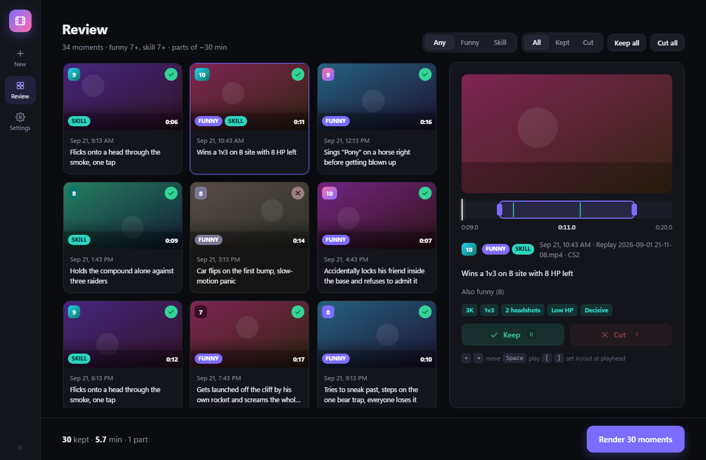
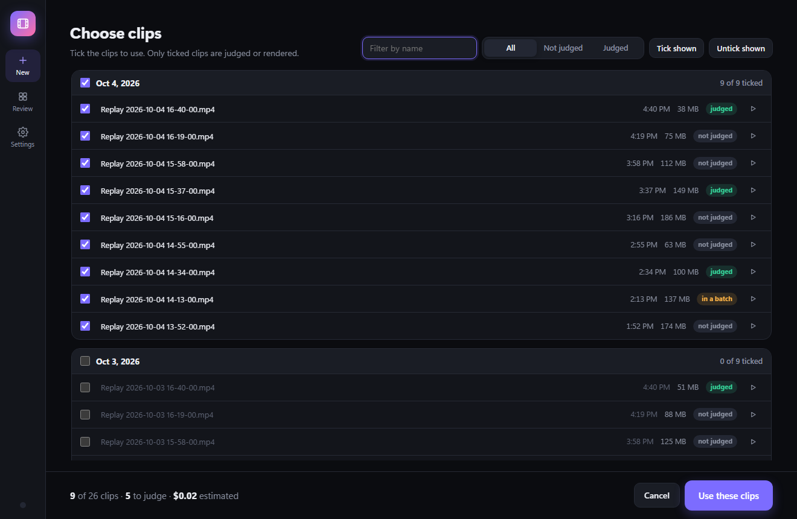
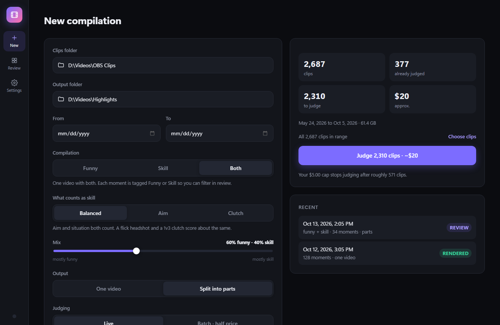

<h1 align="center">Auto Clip Compiler</h1>

Turns a folder of game clips into compilations of your funniest moments, your best plays, or both.

## Overview

You save replays while you play (OBS replay buffer, ShadowPlay, or any recorder that writes video
files). Auto Clip Compiler goes through all of them for you:

1. **Judge.** Google's Gemini watches *and listens to* each clip. You choose what it looks for:
   - **Funny:** the moments that are actually funny: banter, laughter, fails, unexpected outcomes.
     Plain skill plays and generic loudness don't count.
   - **Skill:** your best plays, scored on how hard they were, not how many kills they had (see
     [How skill is judged](#how-skill-is-judged)).
   - **Both:** one video with both kinds, each moment tagged Funny or Skill.

   Each moment gets a 1 to 10 score and a one-line reason.
2. **Review.** Every moment is shown as a card with a preview. Keep or cut it, trim the start and
   end, all from the keyboard if you like.
3. **Render.** The kept moments are cut from your original, full-quality clips into one video of a
   set length, or into parts of about N minutes each. Volume is evened out between clips, and a
   DaVinci Resolve timeline is written next to each video in case you want to edit further.

Replays that were saved more than once (the same moment in two overlapping clips) play only once.
Your clips are never modified or moved.

### Features

- **Funny, Skill or Both.** Pick the compilation type per run. Switching never re-pays for what is
  already judged, and a funny-only run costs exactly what it always did.
- **Choose exactly which clips.** Use a whole folder or date range, or tick specific clips in a list
  grouped by day, with each clip marked as judged (free) or not, and a play button to check it first.
  Only ticked clips are judged, so picking costs nothing extra; it can only save money.
- **Live or Batch judging.** Live returns results in minutes. Batch costs half as much: the app
  uploads the clips, Google judges them on its side (usually well under an hour, at most 24 hours)
  while your PC can be off, and the app collects the results when you open it.
- **Pay once per clip.** Every judgment is saved. Re-running, changing settings or rendering again
  never costs anything, and clips waiting in a batch are never sent twice.
- **Cost estimate before you start** and a budget cap: once spending nears it, nothing new is sent
  to Google (requests already in flight still finish, so the total can land slightly over).
- **Setups are kept.** After judging, the app looks back up to 30 s before each kept moment, including
  the previous replay when the recording runs on, for the line or action the joke builds on (a name
  callback, the thing that started it) and plays that first. Review shows the quoted line and a
  button to remove it. It costs under a cent per kept moment and is saved like every judgment.
- **Stop at any time.** Nothing already judged is lost; an interrupted batch upload resumes.
- **Drafts.** Every compilation you haven't rendered yet is listed in one place, to reopen or discard
  (discarding moves it to the Recycle Bin and keeps the saved judgments).
- **Runs quietly in the background** at below-normal priority, so games stay smooth.
- **Your API key stays private.** It's stored in Windows Credential Manager, never in a file, and is
  scrubbed from logs.
- Dark and light themes (follows Windows).

### How skill is judged

More kills is not more skill. A fast flick onto a head in CS2 beats a sloppy spray-down of two
players, and a 1v3 clutch on low health beats three kills on enemies who never saw you. So skill is
judged in two steps:

1. **Find the plays.** Gemini watches the whole clip and lists every fight worth a closer look.
2. **Look closely.** For each play, the app cuts a short window from your original recording and
   sends it at a high frame rate, with a zoomed-in view of the crosshair, the kill feed (CS2) and
   the full screen with sound. Gemini reports only facts: headshot or not, how far the crosshair
   flicked, how fast the shot came, range, one-tap or spray, wallbangs and no-scopes, how many
   teammates and enemies were alive, low health, and anything that made it easy (an enemy facing
   away, an NPC, a kill after the round was already decided).

The app turns those facts into the score itself, using a fixed formula. How hard the play was
(the aim and the situation) counts the most. Every kill adds to the score, and each extra kill adds more
than the one before, so a 3K beats a 2K and an ace scores near the top. Anything that made the play
easy pulls the score down. So more kills always help, but they don't automatically win: a sloppy
spray-down of two players lands mid-table (about 4), while one huge flick headshot makes the cut (about 8).
Every skill moment shows the reasons as tags (*Headshot · Big flick · Fast reaction · 1v3*), so a
score is never a mystery.

- **What counts as skill:** *Balanced*, *Aim* (flicks, reaction, headshots first) or *Clutch*
  (winning outnumbered, low health, round on the line first).
- **Games:** tuned for **Counter-Strike 2** and **Rust**, with general shooter rules for anything
  else. The game is detected per clip, or set it in Settings > Skill judging.
- **Re-scoring is free.** Scores are worked out from saved judgments, so changing the focus or
  fine-tuning the scoring (Settings > Skill judging > Fine-tune scoring) never calls Google again.

## Screenshots

| | |
|---|---|
|  First launch |  Adding your Gemini key |
|  Pick clips, see the cost |  Tick specific clips |
|  Funny, Skill or Both |  Reviewing a Both compilation |
|  Live or Batch (half price) |  Reviewing a funny compilation |
|  Live judging |  Batch: Google judges, PC can be off |
|  Rendered parts |  Settings |

Screenshots use demo data.

## Installation

**Requirements:** Windows 10 or 11 (64-bit), an internet connection, and a Google account for the
Gemini API key. Nothing else: Python, FFmpeg and everything the app needs are included.

1. Download **`AutoClipCompiler-Setup-<version>.exe`** from the
   [latest release](https://github.com/KalebDieterle/auto-clip-compiler/releases/latest) and run it.
   To update later, download the newer release and run it over the old install; your settings and
   saved judgments are kept.
   - If Windows shows **"Windows protected your PC"** (SmartScreen), click **More info**, then
     **Run anyway**. This appears because the installer isn't code-signed.
   - No admin rights are needed. It installs for your Windows user only and adds a Start menu entry
     (and a desktop shortcut if you tick the box).
2. Open **Auto Clip Compiler** from the Start menu. The first-run setup asks for three things:
   your Gemini API key, the folder your clips are saved in, and where compilations should go.

### Getting a Gemini API key

1. Open [Google AI Studio](https://aistudio.google.com/apikey) and sign in with a Google account.
2. Click **Create API key** and copy it.
3. Paste it into the app. The app checks it with Google before saving it.

**Free tier vs billing.** Without billing, Google allows only about 20 clips a day, which is enough
to try the app. For a real library, turn on billing for the key in AI Studio (prepaid credit works).

### What it costs

Prices are Gemini 3.8 Flash's paid tier (until 2026-12-31, when Google doubles them).

| Per 30-second clip | Funny | Skill* | Both* |
|---|---|---|---|
| Live | about $0.0045 | about $0.012 | about $0.017 |
| Batch | about $0.0023 | about $0.006 | about $0.008 |

\*Skill costs more because each promising play gets a second, close-up look at a high frame rate.
These figures are estimates until measured on real libraries; the app labels them *approx.* The
app shows the estimate for your folder and the chosen type before anything is spent, and each clip
is only ever paid for once per type.

## Using it

1. **New compilation:** choose the clips folder and optionally a date range. To use only some of
   those clips, click **Choose clips**: tick or untick single clips or whole days, filter by name
   or by judged / not judged, and press play to watch a clip first. The cost estimate follows what you
   tick, and the choice resets when you scan again. Then pick:
   - **Funny**, **Skill** or **Both**. For Skill, what counts most (Balanced, Aim or Clutch); for
     Both, the mix (for example 60% funny, 40% skill);
   - **One video** (the best moments up to a set length) or **Split into parts** (everything good,
     in order, in parts of about N minutes);
   - **Live** or **Batch · half price**. A Skill batch runs as two batches back to back (find the
     plays, then the close-ups), so allow up to two days; the app uploads the second one by itself;
   - a minimum score (7 is a good default; Both has one for each kind) and a budget cap.
2. **Judging:** Live shows progress, moments found and money spent, with a Stop button. Batch shows
   the upload, then waits on Google; you can close the app, and it checks every 2 minutes while open
   and again when you start it.
3. **Review:** click a card to play it. In Skill and Both compilations each card is tagged Funny
   and/or Skill, you can filter by either, and the player shows the skill tags and marks each kill
   on the trim bar.

   | Key | Action |
   |---|---|
   | <kbd>K</kbd> / <kbd>X</kbd> | Keep / cut, then move to the next |
   | <kbd>&larr;</kbd> <kbd>&rarr;</kbd> | Previous / next moment |
   | <kbd>Space</kbd> | Play / pause |
   | <kbd>[</kbd> / <kbd>]</kbd> | Set the start / end at the playhead (or drag the purple handles) |

4. **Render:** videos are saved in a `Compilation <date>` folder inside your output folder, with a
   DaVinci Resolve timeline (`Combined.fcpxml`; in Resolve: File > Import > Timeline).
5. **Drafts:** stopped, cancelled or unrendered compilations wait here. Click one to pick it up again,
   or **Discard** it (a batch still at Google is cancelled first, so nothing unfinished is charged).

## Privacy

To judge a clip, the app makes a small 480p copy (for skill plays, also a few seconds' close-up
of each play), uploads it to Google's Gemini API, and deletes it from Google right after (for batches, as soon as results are collected, or when you cancel).
Nothing else leaves your PC. Your clips, settings and saved judgments stay on your machine.

## Troubleshooting

- **"Smart App Control blocked..." when running the installer.** Smart App Control is a stricter
  Windows feature (on by default only on some fresh Windows 11 installs) with no "run anyway"
  option. The app itself runs on Python's signed launcher and passes it, but the installer is
  unsigned. Check *Windows Security > App & browser control > Smart App Control*; if it's on and
  blocks the installer, contact whoever sent it to you.
- **"Google rejected the API key."** Paste it again in Settings; make sure it was copied in full.
- **Judging stops with "daily limit".** You're on the free tier. Turn on billing in AI Studio, or
  continue tomorrow; nothing judged so far is lost.
- **Logs:** Settings > Storage > Open logs.

## Uninstall

Windows Settings > Apps > Installed apps > Auto Clip Compiler > Uninstall. You'll be asked whether to
also delete your settings, saved judgments and the stored API key; keep them if you might reinstall,
since saved judgments are never paid for again. Your clips and finished compilations are never touched.

## License

Auto Clip Compiler is released under the [MIT License](LICENSE).

The installer also bundles third-party software under its own licenses: [FFmpeg](https://ffmpeg.org/legal.html)
(GPL; its license is included as `ffmpeg\FFMPEG-LICENSE.txt` in the install folder) and the
[Python runtime](https://docs.python.org/3/license.html) (PSF License), plus the Python packages
listed in `requirements.txt`, each under its own license.

---

**Developers:** architecture, tests, the command-line tools and how to build the installer are in
[docs/DEVELOPING.md](docs/DEVELOPING.md).
