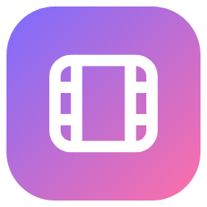
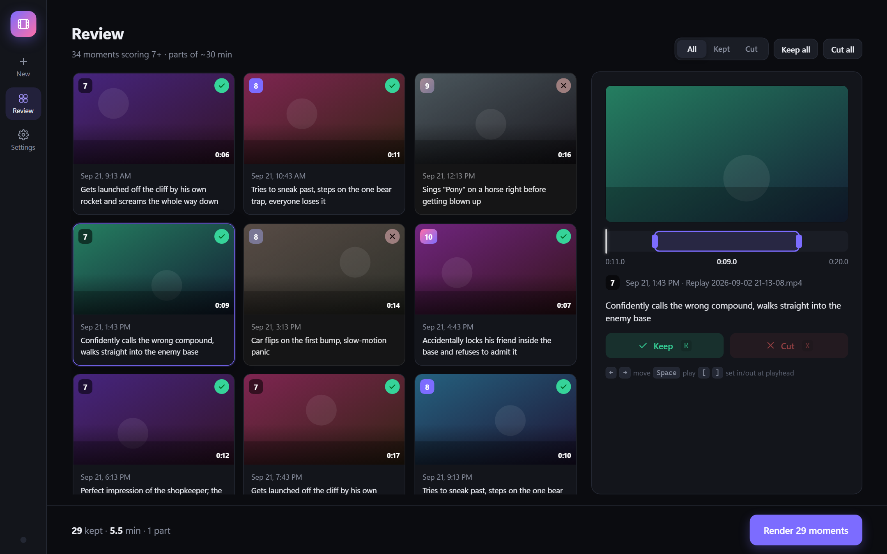
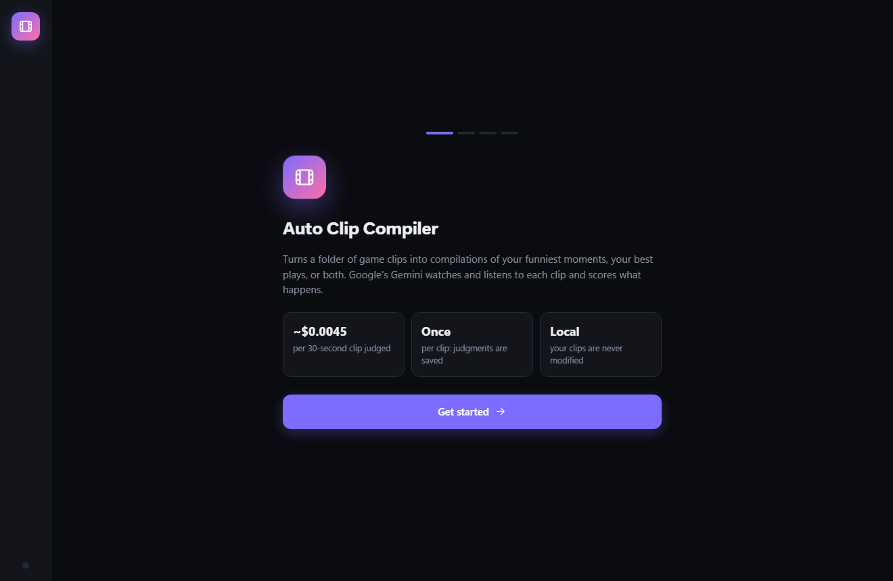
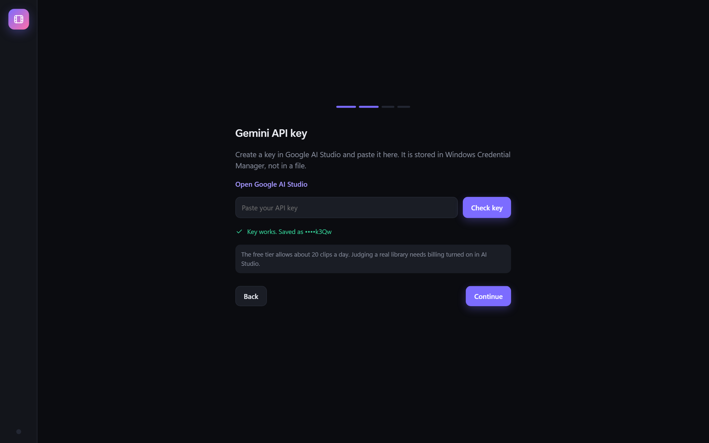
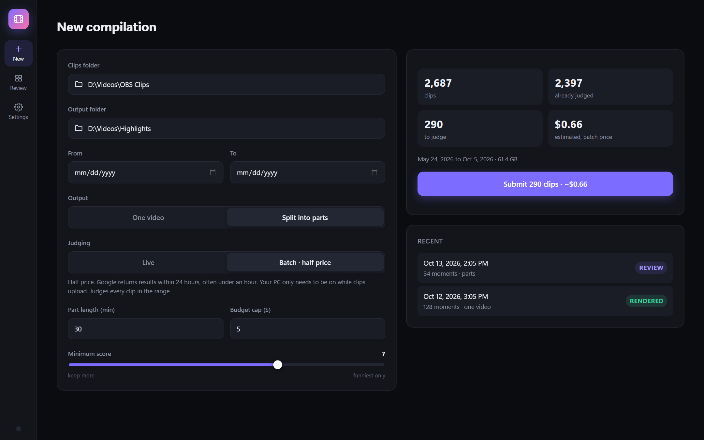
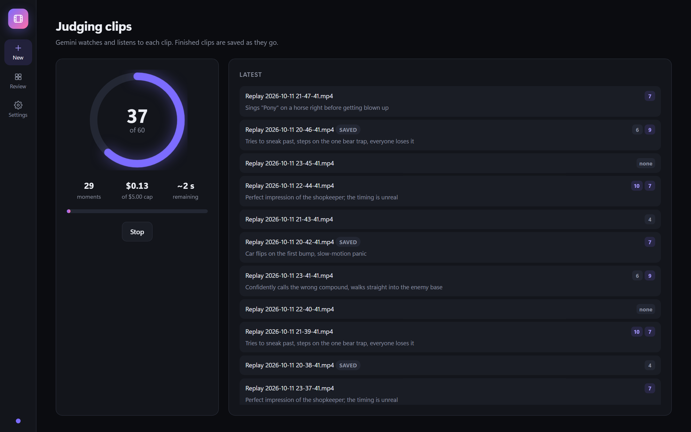
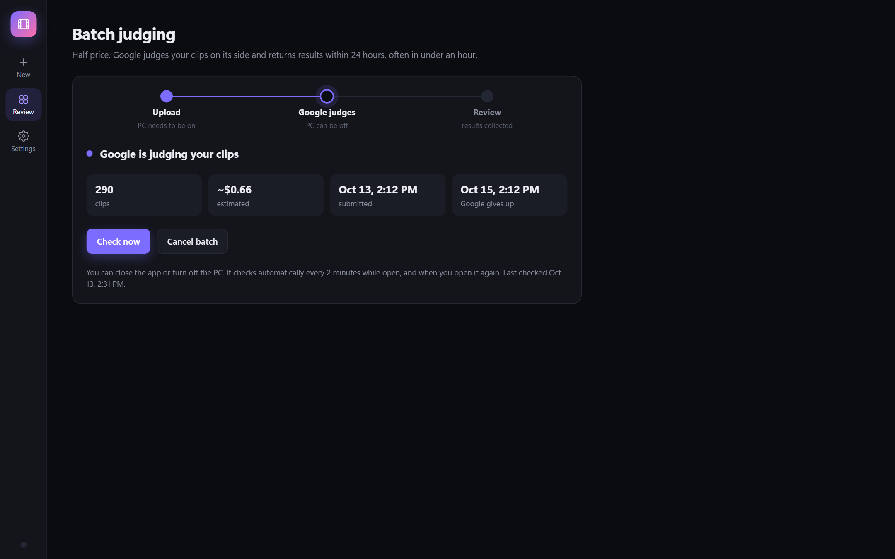
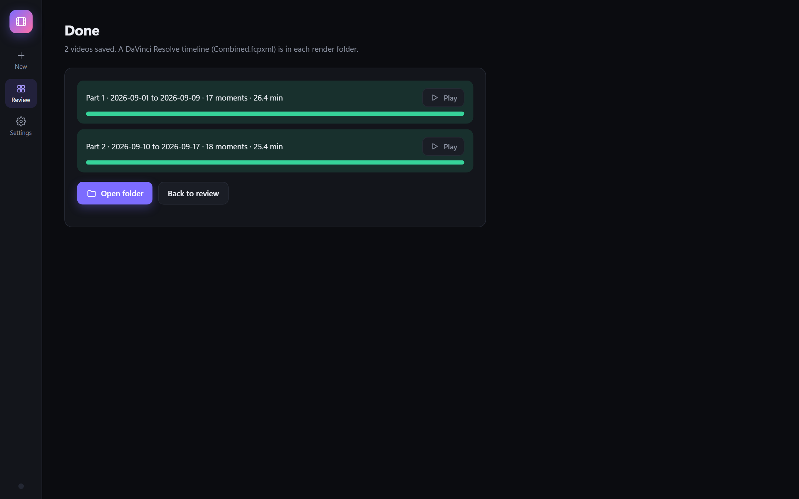
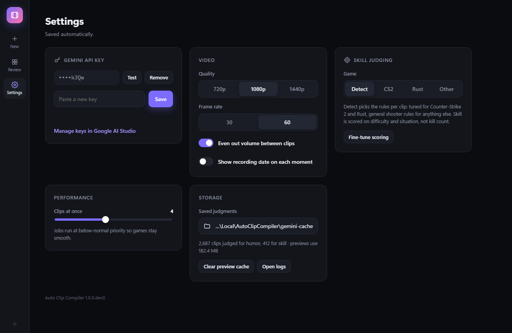

<h1 align="center">Auto Clip Compiler</h1>

Turns a folder of game clips into compilations of the funny moments.

## Overview

You save replays while you play (OBS replay buffer, ShadowPlay, or any recorder that writes video
files). Auto Clip Compiler goes through all of them for you:

1. **Judge.** Google's Gemini watches *and listens to* each clip and finds the moments that are
   actually funny: banter, laughter, fails, unexpected outcomes. Each moment gets a 1 to 10 score
   and a one-line reason. Plain skill plays and generic loudness don't count.
2. **Review.** Every moment is shown as a card with a preview. Keep or cut it, trim the start and
   end, all from the keyboard if you like.
3. **Render.** The kept moments are cut from your original, full-quality clips into one video of a
   set length, or into parts of about N minutes each. Volume is evened out between clips, and a
   DaVinci Resolve timeline is written next to each video in case you want to edit further.

Replays that were saved more than once (the same moment in two overlapping clips) play only once.
Your clips are never modified or moved.

### Features

- **Live or Batch judging.** Live returns results in minutes. Batch costs half as much: the app
  uploads the clips, Google judges them on its side (usually well under an hour, at most 24 hours)
  while your PC can be off, and the app collects the results when you open it.
- **Pay once per clip.** Every judgment is saved. Re-running, changing settings or rendering again
  never costs anything, and clips waiting in a batch are never sent twice.
- **Cost estimate before you start** and a budget cap that stops judging before it's exceeded.
- **Stop at any time.** Nothing already judged is lost; an interrupted batch upload resumes.
- **Runs quietly in the background** at below-normal priority, so games stay smooth.
- **Your API key stays private.** It's stored in Windows Credential Manager, never in a file, and is
  scrubbed from logs.
- Dark and light themes (follows Windows).

## Screenshots

| | |
|---|---|
|  First launch |  Adding your Gemini key |
|  Pick clips, see the cost |  Live or Batch (half price) |
|  Live judging |  Batch: Google judges, PC can be off |
|  Rendered parts |  Settings |

Screenshots use demo data.

## Installation

**Requirements:** Windows 10 or 11 (64-bit), an internet connection, and a Google account for the
Gemini API key. Nothing else: Python, FFmpeg and everything the app needs are included.

1. Download **`AutoClipCompiler-Setup-<version>.exe`** from the
   [latest release](https://github.com/KalebDieterle/auto-clip-compiler/releases/latest) and run it.
   To update later, download the newer release and run it over the old install; your settings and
   saved judgments are kept.
   - If Windows shows **"Windows protected your PC"** (SmartScreen), click **More info**, then
     **Run anyway**. This appears because the installer isn't code-signed.
   - No admin rights are needed. It installs for your Windows user only and adds a Start menu entry
     (and a desktop shortcut if you tick the box).
2. Open **Auto Clip Compiler** from the Start menu. The first-run setup asks for three things:
   your Gemini API key, the folder your clips are saved in, and where compilations should go.

### Getting a Gemini API key

1. Open [Google AI Studio](https://aistudio.google.com/apikey) and sign in with a Google account.
2. Click **Create API key** and copy it.
3. Paste it into the app. The app checks it with Google before saving it.

**Free tier vs billing.** Without billing, Google allows only about 20 clips a day, which is enough
to try the app. For a real library, turn on billing for the key in AI Studio (prepaid credit works).

### What it costs

Prices are Gemini 3.8 Flash's paid tier (until 2026-12-31, when Google doubles them).

| | Per 30-second clip | Per 1,000 clips |
|---|---|---|
| Live | about $0.0045 | about $4.50 |
| Batch | about $0.0023 | about $2.30 |

The app shows the estimate for your folder before anything is spent.

## Using it

1. **New compilation:** choose the clips folder, optionally a date range, then:
   - **One video** (the best moments up to a set length) or **Split into parts** (everything good,
     in order, in parts of about N minutes);
   - **Live** or **Batch · half price**;
   - a minimum score (7 is a good default) and a budget cap.
2. **Judging:** Live shows progress, moments found and money spent, with a Stop button. Batch shows
   the upload, then waits on Google; you can close the app, and it checks every 2 minutes while open
   and again when you start it.
3. **Review:** click a card to play it.

   | Key | Action |
   |---|---|
   | <kbd>K</kbd> / <kbd>X</kbd> | Keep / cut, then move to the next |
   | <kbd>&larr;</kbd> <kbd>&rarr;</kbd> | Previous / next moment |
   | <kbd>Space</kbd> | Play / pause |
   | <kbd>[</kbd> / <kbd>]</kbd> | Set the start / end at the playhead (or drag the purple handles) |

4. **Render:** videos are saved in a `Compilation <date>` folder inside your output folder, with a
   DaVinci Resolve timeline (`Combined.fcpxml`; in Resolve: File > Import > Timeline).

## Privacy

To judge a clip, the app makes a small 480p copy, uploads it to Google's Gemini API, and deletes it
from Google right after (for batches, as soon as results are collected, or when you cancel).
Nothing else leaves your PC. Your clips, settings and saved judgments stay on your machine.

## Troubleshooting

- **"Smart App Control blocked..." when running the installer.** Smart App Control is a stricter
  Windows feature (on by default only on some fresh Windows 11 installs) with no "run anyway"
  option. The app itself runs on Python's signed launcher and passes it, but the installer is
  unsigned. Check *Windows Security > App & browser control > Smart App Control*; if it's on and
  blocks the installer, contact whoever sent it to you.
- **"Google rejected the API key."** Paste it again in Settings; make sure it was copied in full.
- **Judging stops with "daily limit".** You're on the free tier. Turn on billing in AI Studio, or
  continue tomorrow; nothing judged so far is lost.
- **Logs:** Settings > Storage > Open logs.

## Uninstall

Windows Settings > Apps > Installed apps > Auto Clip Compiler > Uninstall. You'll be asked whether to
also delete your settings, saved judgments and the stored API key; keep them if you might reinstall,
since saved judgments are never paid for again. Your clips and finished compilations are never touched.

## License

Auto Clip Compiler is released under the [MIT License](LICENSE).

The installer also bundles third-party software under its own licenses: [FFmpeg](https://ffmpeg.org/legal.html)
(GPL; its license is included as `ffmpeg\FFMPEG-LICENSE.txt` in the install folder) and the
[Python runtime](https://docs.python.org/3/license.html) (PSF License), plus the Python packages
listed in `requirements.txt`, each under its own license.

---

**Developers:** architecture, tests, the command-line tools and how to build the installer are in
[docs/DEVELOPING.md](docs/DEVELOPING.md).
